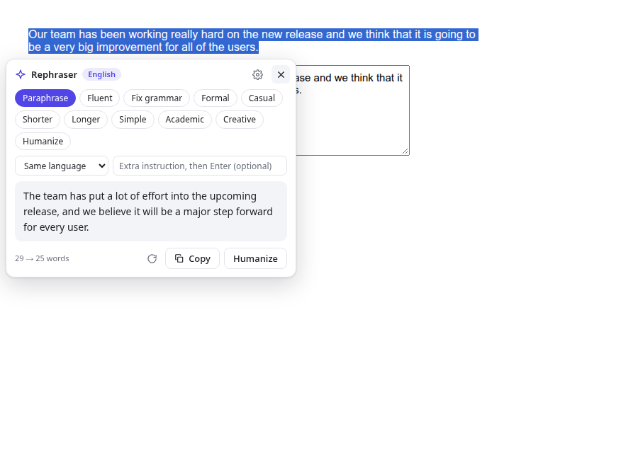
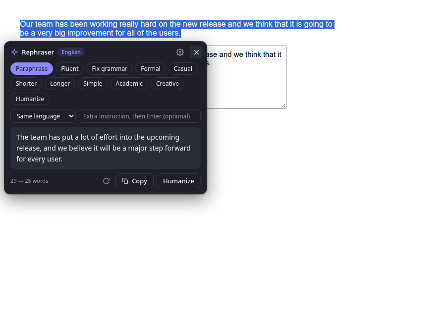
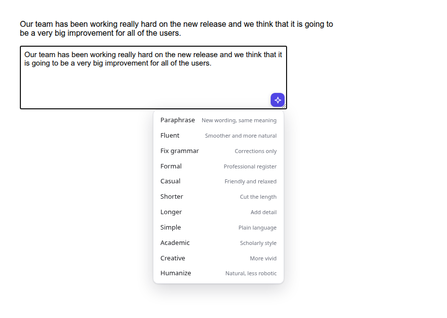
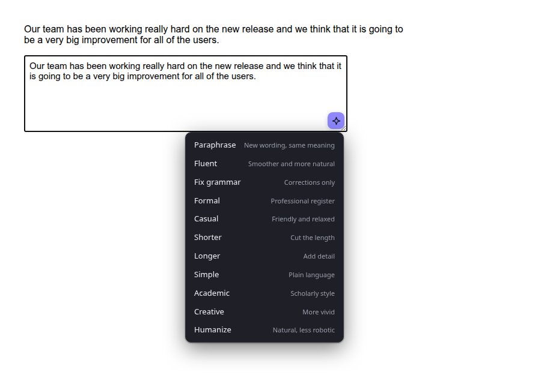

# Rephraser

A Chrome extension that paraphrases, corrects, humanizes and translates text on any page using
your own Claude API key.

| Select text, get the rewrite | Dark theme |
| --- | --- |
|  |  |

| Icon inside a focused field | Dark theme |
| --- | --- |
|  |  |

## Install

1. Open `chrome://extensions`, turn on **Developer mode**, choose **Load unpacked** and select this folder.
2. The settings page opens. Paste a Claude API key (create one at
   [platform.claude.com → API keys](https://platform.claude.com/settings/keys)) and choose **Save & test**.

A claude.ai chat subscription does not include API access; the key comes from a Claude Console account.

## Use

- **Select text** on any page. Click the icon that appears at the end of the selection: the panel shows
  the rewrite and the detected language, with **Copy**, **Replace** (in editable fields) and
  **Humanize & replace**.
- **In a text field**, an icon appears at the right edge once the field has some text. It opens a menu of
  modes that act on the whole field, or on the selection inside it.
- **Modes**: Paraphrase, Fluent, Fix grammar, Formal, Casual, Shorter, Longer, Simple, Academic,
  Creative, Humanize. Switch mode in the panel to rewrite again, pick an output language to translate,
  or type an extra instruction and press Enter.
- **Shortcuts**: `Alt+Shift+P` paraphrase, `Alt+Shift+H` humanize, `Alt+Shift+G` fix grammar, `Esc` to
  close. Also available from the right-click menu.
- **Toolbar popup**: quick rewrite box, recent rewrites, and a switch to hide the icons on the current site.

## Privacy

The API key is stored in this browser profile only (`chrome.storage.local`, restricted to extension
contexts so web pages and content scripts cannot read it). Text is sent only to `api.anthropic.com`,
and only when you ask for a rewrite. History stays on the device and can be turned off.

## Layout

| File | Role |
| --- | --- |
| `src/background.js` | Service worker: API key, streaming jobs, context menu, shortcuts, history |
| `src/api.js` | Claude Messages API client (streaming, retries, error mapping) |
| `src/content.js` | In-page UI (closed shadow root) and in-place replacement |
| `src/shared.js` | Modes, models, languages, default settings |
| `src/options.*`, `src/popup.*` | Settings page and toolbar popup |
| `tools/make-icons.js` | Regenerates `icons/` |

No build step and no dependencies.
